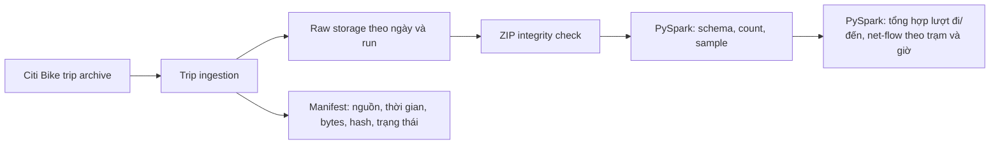

# Citi Bike StationPulse

StationPulse là dự án học thuật về kỹ thuật dữ liệu dùng **PySpark** và dữ liệu chuyến đi Citi Bike. Pipeline hiện tải archive lịch sử theo tháng, giữ nguyên dữ liệu nguồn trong raw storage, ghi manifest để truy vết và dùng Spark kiểm tra dữ liệu.

## Trạng thái dự án

Checkpoint 2 đã có evidence chạy thật trên Windows với Python 3.11.9, Java 21.0.8 và PySpark/Spark 3.5.9. Trong lần kiểm tra workspace ngày 2026-10-23, bộ test, environment check, raw verification và phân tích đều chạy bằng Python 3.12.14, Java 21.0.8 và PySpark/Spark 3.5.9.

| Hạng mục | Kết quả đã ghi nhận |
|---|---|
| Environment | Smoke test `spark.range(1_000_000).count()` PASS; lần chạy lại 2026-10-23 dùng Python 3.12.14 |
| Data source | Citi Bike, Jersey City, tháng 01/2024 (`JC-202401`) |
| Source access | Dry-run ngày 2026-10-23 nhận HTTP 200; Content-Length 1.883.296 byte |
| Ingestion | Tải archive thật thành công; 1.883.296 byte |
| Raw integrity | ZIP hợp lệ; SHA-256 `d59d149f200fb81e204099afb0f76f1b02267bb2d605e92309e6f9974b176e15` |
| Spark verification | Lần chạy lại 2026-10-23 đọc schema, đếm 50.661 dòng và hiển thị 5 dòng mẫu |
| Automated tests | 28/28 test đạt (23 test hệ thống/ingestion + 5 test pipeline mới) |
| Checkpoint 3 Pipeline | Hoàn thành end-to-end (`src/pipeline.py`), làm sạch 49.838 chuyến, join 127 trạm |
| Baseline Runtime | Tổng 992.06s (~16.5 phút); chi tiết tại [Báo cáo Checkpoint 3](reports/checkpoint3.md) |

Các log và dữ liệu raw trên máy chạy được `.gitignore` loại khỏi Git. Hướng dẫn chạy lại để tái tạo evidence nằm ở phần [Chạy dự án](#chạy-dự-án). Checkpoint 2 tập trung vào ingestion và raw verification; ngoài phạm vi checkpoint, script phân tích net-flow tháng 01/2024 hiện đã được triển khai và có output tái tạo được.

## Phạm vi và cách hiểu chỉ số

Dữ liệu đã xác minh là archive Jersey City tháng 01/2024. Giai đoạn phân tích có thể tổng hợp số chuyến đi và đến theo trạm, theo giờ. Chỉ số dự kiến:

```text
net_flow = số chuyến đến - số chuyến đi
```

Net-flow chỉ là chỉ báo từ luồng chuyến đi, không phải số xe thực tế tại trạm. Dữ liệu này không mô tả đầy đủ điều chuyển xe, sức chứa dock, xe ngừng hoạt động hoặc mọi trường hợp trả xe ngoài trạm. Nhóm cần chốt thêm khoảng thời gian và khu vực nếu muốn kết luận về xu hướng rộng hơn một tháng dữ liệu.

## Kiến trúc



## Cấu trúc repository

```text
.
├── config/project.example.yaml  # Cấu hình mẫu, không chứa secret
├── data/
│   ├── raw/                     # Dữ liệu gốc cục bộ, bị gitignore
│   ├── sample/                  # Ghi chú về dữ liệu mẫu
│   └── snapshots/               # GBFS snapshot cục bộ, bị gitignore
├── docs/                        # Kiến trúc, schema, evidence và câu hỏi phân tích
├── logs/                        # Log thực thi cục bộ, bị gitignore
├── metadata/                    # Ghi chú manifest và truy vết
├── src/
│   ├── common/                  # Config, hashing, logging và manifest
│   ├── env_check.py             # Kiểm tra môi trường và Spark smoke test
│   ├── ingest_trips.py          # Tải archive chuyến đi theo tháng
│   ├── ingest_gbfs.py           # Tải GBFS snapshot tùy chọn
│   ├── raw_verify.py            # Kiểm tra ZIP/CSV/JSON bằng Spark
│   └── analyze_trips.py         # Net-flow theo trạm/giờ cho JC-202401
└── tests/                       # Unit test và Spark integration test
```

## Yêu cầu

- Windows PowerShell (các ví dụ bên dưới), Git và Python 3.10–3.12.
- JDK 17 hoặc 21; cần `java -version` hoạt động trong terminal.
- PySpark 3.5.x được cài từ `requirements.txt`.
- Chạy Spark local (`local[*]`); không cần dựng Spark cluster.

Phiên bản dùng cho lần chạy lại gần nhất: Python 3.12.14, Java 21.0.8, PySpark/Spark 3.5.9. Evidence ingestion ban đầu được tạo với Python 3.11.9.

## Cài đặt

```powershell
git clone https://github.com/Cayder123/CitiBike-StationPulse.git
Set-Location .\CitiBike-StationPulse

python -m venv .venv
.\.venv\Scripts\python.exe -m pip install --upgrade pip
.\.venv\Scripts\python.exe -m pip install -r requirements.txt
```


## Chạy dự án

### 1. Kiểm tra môi trường

```powershell
.\.venv\Scripts\python.exe src/env_check.py --log-file logs/env_check.txt
```

Lệnh in phiên bản Python, Java, PySpark và Spark, sau đó thực hiện smoke test `spark.range(1_000_000).count()`. Exit code 0 cho biết kiểm tra hoàn tất.

### 2. Chạy test

```powershell
.\.venv\Scripts\python.exe -m pytest tests -v
```

### 3. Kiểm tra nguồn và tải trip archive

```powershell
# Kiểm tra URL và metadata, không lưu archive
.\.venv\Scripts\python.exe src/ingest_trips.py --dataset jc --year 2024 --month 1 --dry-run

# Tải archive, tạo manifest và raw partition
.\.venv\Scripts\python.exe src/ingest_trips.py --dataset jc --year 2024 --month 1
```

Mỗi lần ingest thành công tạo một partition riêng theo dạng:

```text
data/raw/citibike_trips/ingest_date=YYYY-MM-DD/run_YYYYMMDDTHHMMSS_ffffffZ[_NN]/
├── JC-YYYYMM-citibike-tripdata.csv.zip
└── manifest.json
```

Mặc định, lần chạy mới không ghi đè run cũ. Tùy chọn `--skip-existing` chỉ bỏ qua dữ liệu khi manifest thành công và tên file, snapshot, kích thước cùng SHA-256 khớp.

### 4. Xác minh raw archive bằng Spark

```powershell
.\.venv\Scripts\python.exe src/raw_verify.py `
  --path "data/raw/citibike_trips/ingest_date=*/run_*/JC-202401-citibike-tripdata.csv.zip" `
  --log-file logs/raw_verify.txt
```

Verifier chọn partition khớp mới nhất, kiểm tra ZIP, đọc các CSV trong archive bằng Spark, in schema, đếm dòng và hiển thị 5 dòng mẫu. Có thể truyền đường dẫn ZIP cụ thể thay wildcard.

### 5. GBFS (tùy chọn)

```powershell
# Tìm các feed được cấu hình, không lưu snapshot
.\.venv\Scripts\python.exe src/ingest_gbfs.py --dry-run

# Tải station_information và station_status
.\.venv\Scripts\python.exe src/ingest_gbfs.py
```

GBFS cung cấp snapshot hiện thời; không dùng một snapshot để suy ra lịch sử số xe tại trạm. Đây là phần mở rộng, không cần để chạy lại checkpoint trip ingestion.

### 6. Chạy Spark Processing Pipeline (Checkpoint 3)

```powershell
.\.venv\Scripts\python.exe src/pipeline.py
```

Pipeline thực hiện end-to-end các công đoạn:
1. **Trích xuất & Đọc dữ liệu:** Tự động định vị file ZIP raw mới nhất, giải nén và đọc với `TRIPS_SCHEMA`, đồng thời nạp Station Dimension với `STATIONS_SCHEMA`.
2. **Làm sạch (Cleaning):** Loại bỏ trùng lặp `ride_id`, loại bỏ các bản ghi thiếu trường bắt buộc hoặc thời gian kết thúc trước thời gian bắt đầu, loại bỏ chuyến đi ảo (< 1 phút tại cùng trạm). Giảm từ 50.661 dòng xuống 49.838 dòng sạch.
3. **Biến đổi (Transformation):** Tạo các cột phái sinh `trip_duration_min`, `day_type` (weekday/weekend), `hour_of_day`, `end_hour_of_day`.
4. **Kết hợp (Join):** Broadcast Join với 127 trạm chiều để bổ sung tên trạm, tọa độ và sức chứa.
5. **Tổng hợp (Aggregation):**
   - `hourly_station_flow`: Tính số lượt xuất phát, lượt đến và net-flow cho từng trạm theo từng khung giờ và loại ngày (3.713 dòng).
   - `monthly_station_flow`: Tổng hợp hoạt động cả tháng theo từng trạm (127 dòng).
   - `usage_by_member_casual`: Phân tích số chuyến và thời lượng trung bình giữa hội viên (42.014 chuyến, 7,89 phút) và khách vãng lai (7.824 chuyến, 13,32 phút).
6. **Xuất kết quả:** Lưu vào thư mục `output/preview_csv/` và Parquet (nếu môi trường có hỗ trợ native Hadoop).

Xem chi tiết phân tích kế hoạch thực thi (`explain()`), thời gian chạy từng công đoạn và các điểm nghẽn tại [Báo cáo Checkpoint 3](reports/checkpoint3.md).

## Evidence của lần chạy đã ghi nhận

- Snapshot: Jersey City, `2024-01`; nguồn tải là [Citi Bike System Data](https://citibikenyc.com/system-data).
- Raw archive: `data/raw/citibike_trips/ingest_date=2026-10-21/run_20261021T014618_890189Z/JC-202401-citibike-tripdata.csv.zip`.
- Kích thước: 1.883.296 byte; số dòng CSV: 50.661.
- SHA-256: `d59d149f200fb81e204099afb0f76f1b02267bb2d605e92309e6f9974b176e15`.
- Manifest: cùng thư mục với archive; verifier log: `logs/raw_verify.txt`.
- Commit mã nguồn Checkpoint 2: `505f934d5773590f8fdc4bf57af4c78c9b15074a`.

Manifest lưu `git_commit` tại thời điểm ingest (`b062edc00aedacc48ed6e69d1c6a6fc85887a711`). Không chỉnh sửa manifest cũ để thay đổi lịch sử; nếu cần manifest trỏ đúng commit của lần chạy mới, hãy chạy ingestion từ checkout tương ứng.

Raw archive, snapshot và runtime logs được `.gitignore` loại khỏi Git. Chúng tồn tại trên máy đã chạy pipeline; khi clone repo, hãy chạy lại các lệnh ở trên để tạo evidence cục bộ. Không dùng `git add -f` để thêm dữ liệu raw hoặc log runtime.

## Điều khoản dữ liệu

Tham khảo [Citi Bike System Data](https://citibikenyc.com/system-data) và tuân thủ [Data Sharing Policy](https://citibikenyc.com/data-sharing-policy). Không phân phối bộ dữ liệu như một sản phẩm độc lập, tìm cách nhận diện người dùng hoặc ngụ ý Citi Bike bảo trợ dự án. Ghi Citi Bike là nguồn dữ liệu khi trình bày.

## Giới hạn và bước tiếp theo

- Checkpoint 2 xác minh một lần ingest live; test tự động kiểm tra hành vi chạy lại. Khi chạy ba lần, mặc định mỗi lần tạo partition riêng; không ghi đè raw trước đó.
- Phạm vi phân tích đã chốt: archive Jersey City tháng 01/2024 (`JC-202401`). Chạy Spark aggregation bằng lệnh:

```powershell
.\.venv\Scripts\python.exe src\analyze_trips.py
```

  Kết quả cục bộ được ghi vào `data/processed/citibike_trips/2024-01/`: `hourly_station_flow.csv` (trạm × giờ), `monthly_station_flow.csv` (tổng hợp theo trạm), `hourly_demand_by_day_type.csv` (24 giờ × ngày thường/cuối tuần, trung bình chuyến đi theo ngày) và `station_net_flow_extremes.csv` (10 trạm net-flow cao nhất và thấp nhất). Log nằm tại `logs/analyze_trips.txt`. Các output phân tích và log không được commit; có thể tái tạo từ raw archive.
- Kết quả lần chạy: 50.661 chuyến nguồn; 50.660 có mã trạm đi và 50.494 có mã trạm đến. Bảng tháng có 127 station ID; tổng net-flow là -167 do 167 chuyến không có mã trạm đến. Trung bình ngày thường, giờ 17 cao nhất với 189,48 lượt đi/ngày; giờ 18 kế tiếp với 186,17. Cuối tuần, giờ 15 cao nhất với 110,88 lượt đi/ngày. Trạm có net-flow dương lớn nhất là Grove St PATH (JC115, +698); âm lớn nhất là Brunswick St (JC023, -101). Đây là net-flow của chuyến ghi nhận, không phải tồn kho xe thực tế.
- Archive JC có một số chuyến kết thúc tại các trạm ngoài Jersey City/Hoboken; output giữ nguyên mọi station ID có trong archive thay vì tự loại theo địa lý. Nếu báo cáo chỉ cần phân tích trạm trong NJ, cần lọc trạm theo quy tắc địa lý được xác định rõ.
- GBFS snapshot live không được dùng trong phân tích tháng này; nó không thể thay thế lịch sử và không phải artifact cốt lõi của Checkpoint 2.

Xem [evidence checklist](docs/evidence_checklist.md), [kiến trúc](docs/architecture.md), [data dictionary](docs/data_dictionary.md) và [câu hỏi phân tích](docs/analysis_questions.md) để biết thêm chi tiết.
