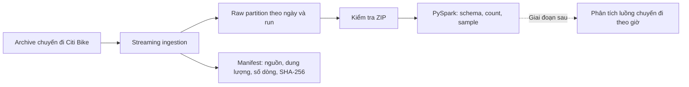

# Citi Bike StationPulse

StationPulse là dự án PySpark dùng dữ liệu chuyến đi Citi Bike để xây dựng pipeline nạp dữ liệu và kiểm tra dữ liệu thô. Ở Checkpoint 2, pipeline tải archive tháng từ nguồn chính thức, giữ nguyên file nguồn, lưu manifest truy vết và dùng Spark đọc schema, đếm dòng, xem dữ liệu mẫu. Snapshot đã xác minh đầu tiên là Jersey City, tháng 01/2024.

## Trạng thái Checkpoint 2

Bằng chứng trên máy ngày 21/10/2026:

- Môi trường: Python 3.11.9, Java 21.0.8, PySpark 3.5.9, Spark 3.5.9. Smoke test `spark.range(1_000_000).count()` đạt.
- Ingestion: tải thành công archive Jersey City tháng 01/2024, dung lượng 1.883.296 byte, gồm 50.661 bản ghi CSV.
- Toàn vẹn dữ liệu: ZIP hợp lệ; SHA-256 là `d59d149f200fb81e204099afb0f76f1b02267bb2d605e92309e6f9974b176e15`.
- Spark Raw Verify: đọc schema, đếm dòng, hiển thị mẫu; Spark dừng sạch.
- Kiểm thử tự động: 23/23 bài test đạt trong 10,33 giây.

Phần phân tích bằng Spark cho giai đoạn tiếp theo chưa được triển khai. Các kết quả net-flow theo trạm/giờ hiện là kế hoạch, chưa phải output của repo.

## Dữ liệu và phạm vi phân tích

Dự án dùng các file lịch sử chuyến đi Citi Bike công khai. Snapshot đã xác minh là `JC-202401-citibike-tripdata.csv.zip`, tương ứng Jersey City tháng 01/2024. Giai đoạn phân tích tiếp theo có thể tổng hợp lượt xuất phát và kết thúc chuyến đi theo trạm, theo giờ.

Chỉ số dự kiến:

```text
net_flow = lượt đến - lượt đi
```

Đây là chỉ số đại diện từ luồng chuyến đi, không phải số xe thực tế tại trạm. Dữ liệu lịch sử không ghi hoạt động điều chuyển xe, sức chứa dock, xe ngừng hoạt động hay mọi trường hợp trả xe đạp điện ngoài trạm. Một số chuyến cũng có thể thiếu mã trạm.

## Kiến trúc



## Cấu trúc repo

```text
.
├── config/project.example.yaml  # Cấu hình mẫu, không chứa secret
├── data/
│   ├── raw/                     # Archive chuyến đi tại máy, bị gitignore
│   ├── sample/                  # Hướng dẫn dữ liệu mẫu nhỏ
│   └── snapshots/               # GBFS snapshots tại máy, bị gitignore
├── docs/                        # Kiến trúc, schema, evidence, câu hỏi phân tích
├── logs/                        # Log thực thi tại máy, bị gitignore
├── metadata/                    # Hướng dẫn metadata dùng chung
├── src/
│   ├── common/                  # Config, hashing, logging và manifest
│   ├── env_check.py             # Kiểm tra Python/Java/PySpark
│   ├── ingest_gbfs.py           # Ingestion snapshot GBFS tùy chọn
│   ├── ingest_trips.py          # Ingestion archive chuyến đi theo tháng
│   └── raw_verify.py            # Kiểm tra ZIP/CSV/JSON bằng Spark
└── tests/                       # Unit test và Spark integration test
```

## Yêu cầu

- Python 3.10 trở lên; phiên bản đã xác minh là Python 3.11.9.
- Java 17 hoặc 21; lần chạy evidence dùng Java 21.0.8.
- PySpark 3.5.x; lần chạy evidence dùng PySpark/Spark 3.5.9.
- Các lệnh bên dưới dùng Windows PowerShell và giả định repo ở `D:\CitiBike-StationPulse`.

## Cài đặt

Trên máy mới, clone repo:

```powershell
git clone https://github.com/Cayder123/CitiBike-StationPulse.git
Set-Location .\CitiBike-StationPulse
```

Tạo môi trường và cài thư viện:

```powershell
python -m venv .venv
\.venv\Scripts\Activate.ps1
python -m pip install --upgrade pip
python -m pip install -r requirements.txt
```

Đảm bảo `java -version` chạy được trong cùng terminal và `JAVA_HOME` trỏ đến JDK. Dự án chạy Spark ở chế độ local (`local[*]`), không yêu cầu dựng Spark cluster riêng.

## Chạy pipeline

### 1. Kiểm tra môi trường

```powershell
python src/env_check.py --log-file logs/env_check.txt
```

Lệnh ghi các phiên bản Python, Java, PySpark và Spark; chạy `spark.range(1_000_000).count()`; trả exit code 0 nếu thành công.

### 2. Chạy kiểm thử

```powershell
python -m pytest tests -v
```

Lần chạy gần nhất đạt 23/23 bài test, trong đó có Spark verify cho ZIP chứa CSV và fixture JSON GBFS.

### 3. Kiểm tra nguồn rồi tải archive tháng

```powershell
# Kiểm tra URL, không tải file
python src/ingest_trips.py --dataset jc --year 2024 --month 1 --dry-run

# Tải archive và tạo manifest
python src/ingest_trips.py --dataset jc --year 2024 --month 1
```

Mỗi lần chạy thành công lưu vào partition mới:

```text
data/raw/citibike_trips/ingest_date=YYYY-MM-DD/run_YYYYMMDDTHHMMSS_ffffffZ[_NN]/
├── JC-YYYYMM-citibike-tripdata.csv.zip
└── manifest.json
```

Theo mặc định, mỗi lần chạy tạo một run riêng và không ghi đè run trước. Tùy chọn `--skip-existing` chỉ bỏ qua archive cùng ngày khi manifest báo thành công và tên file, snapshot, dung lượng cùng SHA-256 khớp với file đang lưu.

### 4. Dùng Spark xác minh archive thô

```powershell
python src/raw_verify.py `
  --path "data/raw/citibike_trips/ingest_date=*/run_*/JC-202401-citibike-tripdata.csv.zip" `
  --log-file logs/raw_verify.txt
```

Verifier chọn partition khớp mới nhất, kiểm tra tính toàn vẹn ZIP, đọc tất cả CSV bên trong bằng Spark, in schema, đếm dòng và hiển thị 5 dòng mẫu. Có thể truyền đường dẫn ZIP cụ thể thay cho wildcard.

### 5. GBFS tùy chọn

```powershell
# Tìm feed đã cấu hình, không lưu snapshot
python src/ingest_gbfs.py --dry-run

# Tải snapshot station_information và station_status
python src/ingest_gbfs.py
```

GBFS là phần mở rộng snapshot hiện thời. Một snapshot không thể đại diện lịch sử số xe tại trạm và không cần thiết để tái tạo lần ingest chuyến đi đã xác minh.

## Bằng chứng dữ liệu đã ghi nhận

| Trường | Giá trị đã xác minh |
|---|---|
| Nguồn | [Citi Bike System Data](https://citibikenyc.com/system-data) — `https://s3.amazonaws.com/tripdata/JC-202401-citibike-tripdata.csv.zip` |
| Snapshot | Jersey City, tháng 01/2024 (`2024-01`) |
| Run ID | `run_20261021T014618_890189Z` |
| Raw archive | `data/raw/citibike_trips/ingest_date=2026-10-21/run_20261021T014618_890189Z/JC-202401-citibike-tripdata.csv.zip` |
| Dung lượng / số dòng | 1.883.296 byte / 50.661 dòng |
| SHA-256 | `d59d149f200fb81e204099afb0f76f1b02267bb2d605e92309e6f9974b176e15` |
| Manifest | `data/raw/citibike_trips/ingest_date=2026-10-21/run_20261021T014618_890189Z/manifest.json` |
| Spark log | `logs/raw_verify.txt` (lưu cục bộ, bị gitignore) |
| Commit Checkpoint 2 | `505f934d5773590f8fdc4bf57af4c78c9b15074a` |

Manifest của lần ingest trên ghi `git_commit` là `b062edc00aedacc48ed6e69d1c6a6fc85887a711`, tức HEAD tồn tại khi pipeline chạy. Commit hiện tại là `505f934d5773590f8fdc4bf57af4c78c9b15074a`; mình không sửa manifest cũ để thay đổi lịch sử. Nếu yêu cầu lineage phải trỏ đúng commit đã nộp, hãy chạy ingestion mới từ checkout đã commit và giữ manifest mới.

Raw data và log bị `.gitignore` loại khỏi Git. Giữ chúng trên máy dùng để nghiệm thu và mở đúng đường dẫn hoặc terminal output khi trình bày. Không dùng `git add -f` để thêm archive hoặc log runtime.

## Điều khoản sử dụng dữ liệu

Citi Bike công bố lịch sử chuyến đi cho mục đích phân tích. Hãy dùng [trang System Data](https://citibikenyc.com/system-data) và tuân thủ [Data Sharing Policy](https://citibikenyc.com/data-sharing-policy) hiện hành. Chính sách không cho phép phân phối hoặc bán dữ liệu như một bộ dữ liệu độc lập, truy cập ngoài giao diện được cấp phép, tìm cách nhận diện người dùng hoặc ngụ ý Citi Bike bảo trợ dự án. Khi trình bày, ghi Citi Bike là nguồn dữ liệu.

## Trạng thái và phần tiếp theo

- Checkpoint 2 có một lần ingest live và unit test xác nhận chính sách chạy lại. Khi báo cáo, giải thích rằng ba lần chạy mặc định tạo ba partition riêng; không cần tải cùng archive ba lần chỉ để chứng minh.
- Manifest hiện tại có đủ các trường nguồn, thời gian, bytes, record count, SHA-256, run ID, đích lưu và status. `git_commit` ghi HEAD tại thời điểm ingest; tạo một run mới từ commit hiện tại chỉ cần thiết nếu nhóm muốn lineage trỏ chính xác tới commit nộp.
- GBFS snapshot live là phần mở rộng, không thuộc 5 artifact cốt lõi của Checkpoint 2.
- Spark transformation và kết quả phân tích thuộc giai đoạn tiếp theo. Trước khi làm, nhóm cần chốt snapshot tháng 01/2024 chỉ là minh chứng hay là toàn bộ phạm vi phân tích; nếu muốn phân tích xu hướng rộng hơn, chọn thêm khoảng thời gian/khu vực.
- Commit `505f934d5773590f8fdc4bf57af4c78c9b15074a` hiện có ở local `main`, chưa được push; README và một số tài liệu đang có chỉnh sửa rà soát chưa commit.

Checklist evidence và các thông tin nhóm cần chốt trước khi nộp nằm trong [`docs/evidence_checklist.md`](docs/evidence_checklist.md).
