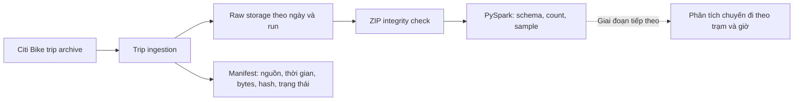

# Citi Bike StationPulse

StationPulse là dự án học thuật về kỹ thuật dữ liệu dùng **PySpark** và dữ liệu chuyến đi Citi Bike. Pipeline hiện tải archive lịch sử theo tháng, giữ nguyên dữ liệu nguồn trong raw storage, ghi manifest để truy vết và dùng Spark kiểm tra dữ liệu.

## Trạng thái dự án

Checkpoint 2 đã được chạy và xác minh trên Windows với Python 3.11.9, Java 21.0.8 và PySpark/Spark 3.5.9.

| Hạng mục | Kết quả đã ghi nhận |
|---|---|
| Environment | `spark.range(1_000_000).count()` hoàn tất thành công |
| Data source | Citi Bike, Jersey City, tháng 01/2024 (`JC-202401`) |
| Ingestion | Tải archive thật thành công; 1.883.296 byte |
| Raw integrity | ZIP hợp lệ; SHA-256 `d59d149f200fb81e204099afb0f76f1b02267bb2d605e92309e6f9974b176e15` |
| Spark verification | Đọc schema, đếm được 50.661 dòng và hiển thị dữ liệu mẫu |
| Automated tests | Lần chạy được ghi nhận: 23/23 test đạt |

Các log và dữ liệu raw trên máy chạy được `.gitignore` loại khỏi Git. Hướng dẫn chạy lại để tái tạo evidence nằm ở phần [Chạy dự án](#chạy-dự-án). Checkpoint hiện tập trung vào ingestion và raw verification; phân tích net-flow là bước tiếp theo, chưa phải kết quả đã triển khai.

## Phạm vi và cách hiểu chỉ số

Dữ liệu đã xác minh là archive Jersey City tháng 01/2024. Giai đoạn phân tích có thể tổng hợp số chuyến đi và đến theo trạm, theo giờ. Chỉ số dự kiến:

```text
net_flow = số chuyến đến - số chuyến đi
```

Net-flow chỉ là chỉ báo từ luồng chuyến đi, không phải số xe thực tế tại trạm. Dữ liệu này không mô tả đầy đủ điều chuyển xe, sức chứa dock, xe ngừng hoạt động hoặc mọi trường hợp trả xe ngoài trạm. Nhóm cần chốt thêm khoảng thời gian và khu vực nếu muốn kết luận về xu hướng rộng hơn một tháng dữ liệu.

## Kiến trúc



## Cấu trúc repository

```text
.
├── config/project.example.yaml  # Cấu hình mẫu, không chứa secret
├── data/
│   ├── raw/                     # Dữ liệu gốc cục bộ, bị gitignore
│   ├── sample/                  # Ghi chú về dữ liệu mẫu
│   └── snapshots/               # GBFS snapshot cục bộ, bị gitignore
├── docs/                        # Kiến trúc, schema, evidence và câu hỏi phân tích
├── logs/                        # Log thực thi cục bộ, bị gitignore
├── metadata/                    # Ghi chú manifest và truy vết
├── src/
│   ├── common/                  # Config, hashing, logging và manifest
│   ├── env_check.py             # Kiểm tra môi trường và Spark smoke test
│   ├── ingest_trips.py          # Tải archive chuyến đi theo tháng
│   ├── ingest_gbfs.py           # Tải GBFS snapshot tùy chọn
│   └── raw_verify.py            # Kiểm tra ZIP/CSV/JSON bằng Spark
└── tests/                       # Unit test và Spark integration test
```

## Yêu cầu

- Windows PowerShell (các ví dụ bên dưới), Git và Python 3.10 hoặc 3.11.
- JDK 17 hoặc 21; cần `java -version` hoạt động trong terminal.
- PySpark 3.5.x được cài từ `requirements.txt`.
- Chạy Spark local (`local[*]`); không cần dựng Spark cluster.

Phiên bản đã dùng để tạo evidence: Python 3.11.9, Java 21.0.8, PySpark/Spark 3.5.9.

## Cài đặt

```powershell
git clone https://github.com/Cayder123/CitiBike-StationPulse.git
Set-Location .\CitiBike-StationPulse

python -m venv .venv
.\.venv\Scripts\python.exe -m pip install --upgrade pip
.\.venv\Scripts\python.exe -m pip install -r requirements.txt
```


## Chạy dự án

### 1. Kiểm tra môi trường

```powershell
.\.venv\Scripts\python.exe src/env_check.py --log-file logs/env_check.txt
```

Lệnh in phiên bản Python, Java, PySpark và Spark, sau đó thực hiện smoke test `spark.range(1_000_000).count()`. Exit code 0 cho biết kiểm tra hoàn tất.

### 2. Chạy test

```powershell
.\.venv\Scripts\python.exe -m pytest tests -v
```

### 3. Kiểm tra nguồn và tải trip archive

```powershell
# Kiểm tra URL và metadata, không lưu archive
.\.venv\Scripts\python.exe src/ingest_trips.py --dataset jc --year 2024 --month 1 --dry-run

# Tải archive, tạo manifest và raw partition
.\.venv\Scripts\python.exe src/ingest_trips.py --dataset jc --year 2024 --month 1
```

Mỗi lần ingest thành công tạo một partition riêng theo dạng:

```text
data/raw/citibike_trips/ingest_date=YYYY-MM-DD/run_YYYYMMDDTHHMMSS_ffffffZ[_NN]/
├── JC-YYYYMM-citibike-tripdata.csv.zip
└── manifest.json
```

Mặc định, lần chạy mới không ghi đè run cũ. Tùy chọn `--skip-existing` chỉ bỏ qua dữ liệu khi manifest thành công và tên file, snapshot, kích thước cùng SHA-256 khớp.

### 4. Xác minh raw archive bằng Spark

```powershell
.\.venv\Scripts\python.exe src/raw_verify.py `
  --path "data/raw/citibike_trips/ingest_date=*/run_*/JC-202401-citibike-tripdata.csv.zip" `
  --log-file logs/raw_verify.txt
```

Verifier chọn partition khớp mới nhất, kiểm tra ZIP, đọc các CSV trong archive bằng Spark, in schema, đếm dòng và hiển thị 5 dòng mẫu. Có thể truyền đường dẫn ZIP cụ thể thay wildcard.

### 5. GBFS (tùy chọn)

```powershell
# Tìm các feed được cấu hình, không lưu snapshot
.\.venv\Scripts\python.exe src/ingest_gbfs.py --dry-run

# Tải station_information và station_status
.\.venv\Scripts\python.exe src/ingest_gbfs.py
```

GBFS cung cấp snapshot hiện thời; không dùng một snapshot để suy ra lịch sử số xe tại trạm. Đây là phần mở rộng, không cần để chạy lại checkpoint trip ingestion.

## Evidence của lần chạy đã ghi nhận

- Snapshot: Jersey City, `2024-01`; nguồn tải là [Citi Bike System Data](https://citibikenyc.com/system-data).
- Raw archive: `data/raw/citibike_trips/ingest_date=2026-10-21/run_20261021T014618_890189Z/JC-202401-citibike-tripdata.csv.zip`.
- Kích thước: 1.883.296 byte; số dòng CSV: 50.661.
- SHA-256: `d59d149f200fb81e204099afb0f76f1b02267bb2d605e92309e6f9974b176e15`.
- Manifest: cùng thư mục với archive; verifier log: `logs/raw_verify.txt`.
- Commit mã nguồn Checkpoint 2: `505f934d5773590f8fdc4bf57af4c78c9b15074a`.

Manifest lưu `git_commit` tại thời điểm ingest (`b062edc00aedacc48ed6e69d1c6a6fc85887a711`). Không chỉnh sửa manifest cũ để thay đổi lịch sử; nếu cần manifest trỏ đúng commit của lần chạy mới, hãy chạy ingestion từ checkout tương ứng.

Raw archive, snapshot và runtime logs được `.gitignore` loại khỏi Git. Chúng tồn tại trên máy đã chạy pipeline; khi clone repo, hãy chạy lại các lệnh ở trên để tạo evidence cục bộ. Không dùng `git add -f` để thêm dữ liệu raw hoặc log runtime.

## Điều khoản dữ liệu

Tham khảo [Citi Bike System Data](https://citibikenyc.com/system-data) và tuân thủ [Data Sharing Policy](https://citibikenyc.com/data-sharing-policy). Không phân phối bộ dữ liệu như một sản phẩm độc lập, tìm cách nhận diện người dùng hoặc ngụ ý Citi Bike bảo trợ dự án. Ghi Citi Bike là nguồn dữ liệu khi trình bày.

## Giới hạn và bước tiếp theo

- Checkpoint 2 xác minh một lần ingest live; test tự động kiểm tra hành vi chạy lại. Khi chạy ba lần, mặc định mỗi lần tạo partition riêng; không ghi đè raw trước đó.
- Chưa triển khai Spark transformation hoặc kết quả phân tích net-flow; đây là phần tiếp theo của dự án.
- Nhóm cần xác nhận snapshot JC tháng 01/2024 chỉ là evidence hay là phạm vi phân tích cuối. Nếu cần xu hướng rộng hơn, chốt thêm tháng/khu vực trước khi ingest.
- GBFS snapshot live không phải artifact cốt lõi của Checkpoint 2.

Xem [evidence checklist](docs/evidence_checklist.md), [kiến trúc](docs/architecture.md), [data dictionary](docs/data_dictionary.md) và [câu hỏi phân tích](docs/analysis_questions.md) để biết thêm chi tiết.
