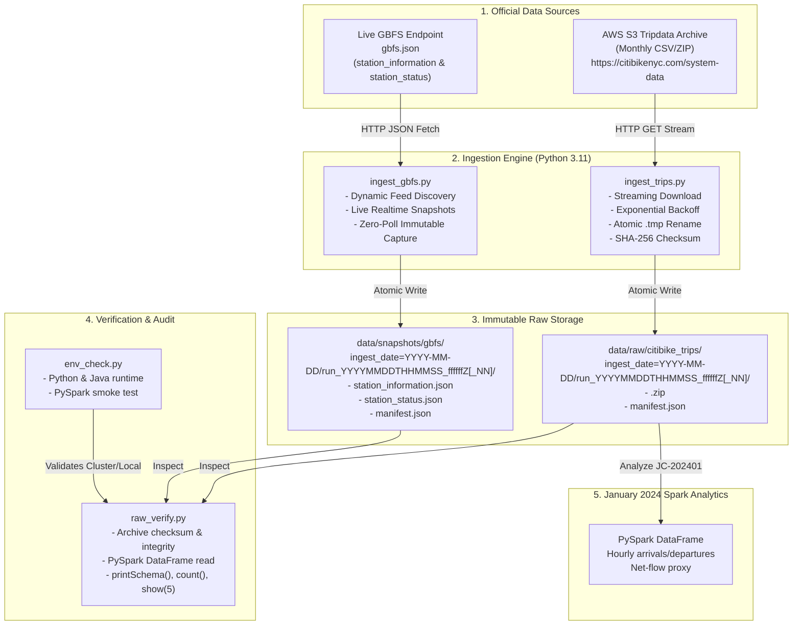

# StationPulse: System Architecture & Ingestion Pipeline

## 1. Overview & Project Goal

StationPulse is an academic big-data pipeline designed to analyze Citi Bike trip demand and evaluate station bike imbalance in the New York City / Jersey City metropolitan area using Apache Spark (PySpark).

The project covers the Checkpoint 2 ingestion pipeline and an initial January 2024 analytics step:
- **Checkpoint 2**: Environment setup, robust data ingestion, immutable raw storage, cryptographic audit manifests, log sanitization, safe rerun isolation, and PySpark raw data verification.
- **Analytics**: PySpark hourly pickup/dropoff aggregations and station net-flow proxy for the `JC-202401` archive. Additional periods and modeling are outside the current scope.

---

## 2. High-Level Architecture Diagram



---

## 3. Storage Hierarchy & Partitioning Layout

All downloaded raw artifacts and real-time snapshots are strictly immutable. Rerunning ingestion pipelines generates a new timestamped partition rather than overwriting historical files:

```
D:\CitiBike-StationPulse/
├── data/
│   ├── raw/
│   │   └── citibike_trips/
│   │       └── ingest_date=YYYY-MM-DD/
│   │           └── run_YYYYMMDDTHHMMSS_ffffffZ/
│   │               ├── JC-202401-citibike-tripdata.csv.zip
│   │               └── manifest.json
│   ├── snapshots/
│   │   └── gbfs/
│   │       └── ingest_date=YYYY-MM-DD/
│   │           └── run_YYYYMMDDTHHMMSS_ffffffZ/
│   │               ├── station_information.json
│   │               ├── station_status.json
│   │               └── manifest.json
│   └── sample/
│       └── README.md
└── logs/
    ├── env_check.txt
    └── raw_verify.txt
```

---

## 4. Key Architectural Guarantees

1. **Byte-Level Immutability**:
   Raw archives are saved exactly as received from official servers. No records are filtered, cleaned, re-encoded, or converted (e.g. Parquet) inside `data/raw/`.
2. **Atomic Writes via Temporary Files**:
   Downloads stream to `.tmp` files. The final destination file only appears once streaming completes and file size matches expectations, preventing partial or corrupt downloads.
3. **Cryptographic Lineage (SHA-256)**:
   Every artifact is hashed using streaming SHA-256. The hash is saved alongside metadata in `manifest.json`.
4. **Isolated Rerun Capability**:
    With the default policy, each ingestion run creates a distinct `run_YYYYMMDDTHHMMSS_ffffffZ` directory and preserves its artifact and manifest. The optional `--skip-existing` policy can skip a valid same-day monthly artifact.
5. **No Secret / Credential Leakage**:
   All loggers pass through a sanitization filter that intercepts auth tokens and sensitive headers. `.gitignore` strictly protects raw datasets and environment files from Git commits.
